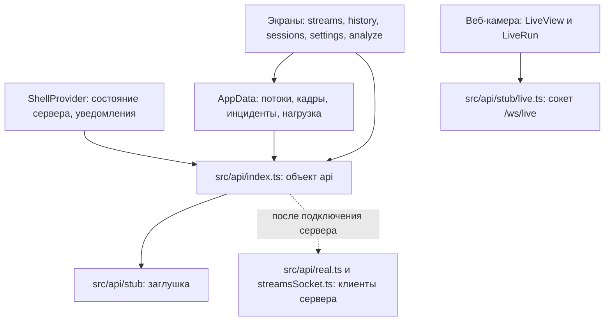
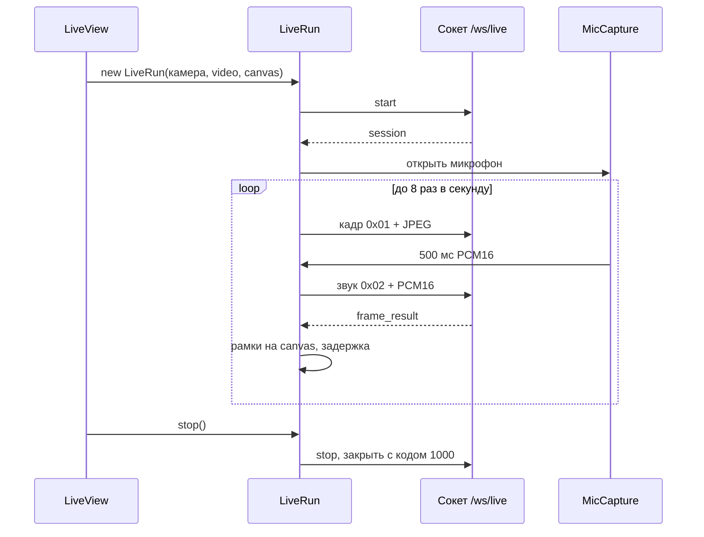

# Архитектура

Одностраничное приложение на React 19 и react-router 8, сборка Vite, язык TypeScript в строгом режиме. Внешних библиотек состояния и UI-компонентов нет: состояние держат классы `AppData` и `Store`, компоненты написаны в проекте.

## Слои

- Экраны не обращаются к сети сами. Они вызывают объект `api` или читают общее состояние из `AppData`.
- `src/api/index.ts` — единственное место, где выбирается реализация: заглушка или клиенты сервера. Тесты экранов подменяют `api` через `vi.mock("../api")`.
- Формы данных описаны в `src/api/types.ts` и `src/live/protocol.ts`. Контракт — в [api.md](api.md).

## Общее состояние

### ShellProvider

`src/shell/context.tsx`. Контекст оболочки, доступен через `useShell()`:

- `health` и `healthError` — опрос `GET /api/health` раз в 5 с. По ним рисуется баннер под шапкой и вкладка «Система».
- `toast(text, error?)` — уведомление в правом нижнем углу на 4 с.
- `addStreamOpen` и `setAddStreamOpen` — открыт ли диалог «Добавить поток».

### AppData

`src/state/appData.ts`. Один экземпляр на всё приложение (`appData`). `Layout` запускает его при монтировании (`appData.start()`) и останавливает при размонтировании. Внутри счётчик ссылок, поэтому повторный `start()` не открывает второй сокет.

Что хранит `AppData`:

| Поле | Источник |
|---|---|
| `streams` | `GET /api/streams`, перечитывается после смены статуса потока |
| кадр и результат каждого потока (`feed(id)`) | `/ws/streams`: `stream_result` и бинарные кадры |
| статистика потока за 30 с (`RollingStats`) | задержка p50/p95, доля пригодных лиц, медиана `face_px` |
| `system` | сообщения `system` |
| `newIncidents` | `GET /api/events?kind=negative&state=new&limit=100`, затем сообщения `event` |
| `hidden` | инциденты, баннер которых скрыт на экране потока (только в этой вкладке) |

Подписка компонентов идёт через `Store` (`src/state/store.ts`) и `useSyncExternalStore`. `Store` хранит номер версии и увеличивает его при изменении. Хранилищ три:

| Хранилище | Хук | Когда меняется |
|---|---|---|
| `streamsStore` | `useStreams()` | список потоков |
| `feedStore` | `useFeedVersion()` | результаты, кадры и нагрузка; не чаще раза в 250 мс (`emitThrottled`) |
| `incidentsStore` | `useIncidents()` | новые инциденты |

`streamNow(stream)` собирает то, что поток показывает сейчас: последний результат, если поток в эфире и результат моложе 3 с, лица и самое тяжёлое решение. Сетка и экран потока используют одну эту функцию.

### Данные отдельных экранов

Журнал событий, сеансы, настройки, очередь файлов и журнал потока загружают свои данные сами в `useEffect` и хранят их в состоянии компонента. Где нужно, экран опрашивает сервер по таймеру: очередь файлов раз в 1 или 10 с, сеансы раз в 5 с, пока есть идущие сеансы, журнал потока раз в интервал журнала.

## Поток данных камер

1. `AppData` открывает `/ws/streams` через `api.connectStreams(onMessage, onFrame, onConnection)`.
2. Бинарный кадр превращается в `blob:` URL. Предыдущий URL этого потока освобождается.
3. `stream_result` сохраняется как последний результат потока и добавляется в статистику. Задержка считается как `Date.now() − (decode_ts + смещение)`, где смещение часов берётся из последнего `system`.
4. `stream_status` меняет статус потока и через 500 мс перечитывает список потоков. Несколько изменений подряд дают один запрос.
5. `event` обновляет колокольчик и передаётся подписчикам `appData.onEvent()`, например журналу событий.
6. После обрыва все плитки очищаются. После переподключения список потоков и инциденты перечитываются.

`FrameView` (`src/streams/FrameView.tsx`) рисует кадр в рамке 16:9 и кладёт поверх рамки лиц в процентах от размера кадра. Тот же компонент показывает видео в плеере записи.

## Сеанс веб-камеры

`LiveView` (`src/live/LiveView.tsx`) отвечает за React-часть: кнопки, запрос камеры (`getUserMedia`, желаемое разрешение 1280×720), тексты ошибок, плитки и панель «Посетитель». Всё остальное делает класс `LiveRun` (`src/live/run.ts`) вне React:

- **Захват кадра.** Каждые 125 мс кадр из `<video>` рисуется на скрытый canvas (длинная сторона до 640 px) и кодируется в JPEG с качеством 0,8. Захват пропускается, если вкладка скрыта, предыдущий кадр ещё кодируется или в сокете больше 64 КБ неотправленных данных.
- **Результат.** Клиент помнит размер JPEG для каждого `frame_id` (до 512 кадров). Ответ на кадр старше уже обработанного игнорируется. Рамки рисуются на canvas поверх видео в `requestAnimationFrame` с учётом `object-fit: contain` (`containRect`, `drawOverlay` в `src/live/overlay.ts`).
- **Задержка.** После отрисовки в окно добавляется `время отрисовки − capture_ts`. `LatencyWindow` (`src/live/latency.ts`) считает p50 и p95 за 60 с. Частота ответов считается за 5 с. Статистика обновляется раз в 500 мс.
- **Устаревание.** Если ответа нет больше 1 с, рамки и панель очищаются.
- **Микрофон.** `MicCapture` (`src/live/mic.ts`) открывает микрофон отдельно от камеры. Звук идёт в `AudioWorklet` (`src/live/pcm-worklet.ts`): моно, ФНЧ 6,5 кГц (FIR с окном Блэкмана, `src/live/resample.ts`), понижение до 16 кГц, PCM16, куски по 500 мс. Основной поток ставит куску время начала: время прихода минус 500 мс. Выключение микрофона закрывает `AudioContext` и освобождает устройство.
- **Часы.** Кадры и звук используют одно время клиента: `performance.timeOrigin + performance.now()` (`src/live/clock.ts`).

Сокет `LiveRun` описан интерфейсом `LiveSocket` — это та часть `WebSocket`, которую использует класс. Сейчас сокет создаёт заглушка `openLiveSocket()`.

## Время

| Источник | Время в данных |
|---|---|
| Потоки RTSP | epoch ms часов сервера |
| Веб-камера | epoch ms часов клиента (`capture_ts`) |
| Запись | миллисекунды от начала записи |

`isMediaTime(ms)` в `src/ui/format.ts` считает значение меньше `1e11` временем внутри записи. По нему журнал и колокольчик выбирают формат времени («запись 04:06» или «10.10, 14:03:07») и ссылку на источник.

## Интерфейс и оформление

- `src/styles/tokens.css` — цвета, отступы и размеры в CSS-переменных. Тема одна, тёмная.
- `src/styles/base.css` — шрифты IBM Plex Sans и IBM Plex Mono (латиница и кириллица) из пакетов `@fontsource`, базовые стили.
- `src/styles/app.css` — стили компонентов и экранов.
- `src/ui/controls.tsx` — общие элементы: `Tile`, `Segmented`, `MultiChips`, `Stepper`, `Toggle`, `Disclosure`, `Dialog`, `DropdownButton`, `DecisionChip`, `StatusLabel`, `StatusBadge`, `SystemLoadLine`, хук `useDismiss` и функция `download`.
- `src/ui/format.ts` — форматирование чисел и времени по-русски (десятичная запятая), подписи эмоций, решений, статусов и типов камер.
- `src/ui/icons.tsx` — иконки во встроенном SVG.

Рамки на canvas не могут читать CSS-переменные напрямую, поэтому `overlay.ts` берёт их значения через `getComputedStyle`.

## Сборка без внешних адресов

Приложение должно работать без интернета. Поэтому:

- шрифты, иконки и `AudioWorklet` (`?worker&url`) входят в сборку;
- плагин `stripExternalUrls` в `vite.config.ts` переписывает известные адреса из библиотек, которые никогда не загружаются (ссылки на документацию в сообщениях об ошибках React и react-router), и останавливает сборку, если в бандле есть любой другой `http://` или `https://` адрес;
- `Dockerfile` после сборки ещё раз ищет такие адреса в `dist/`.
